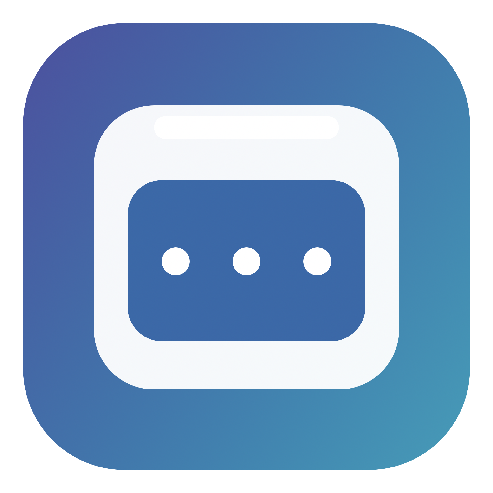
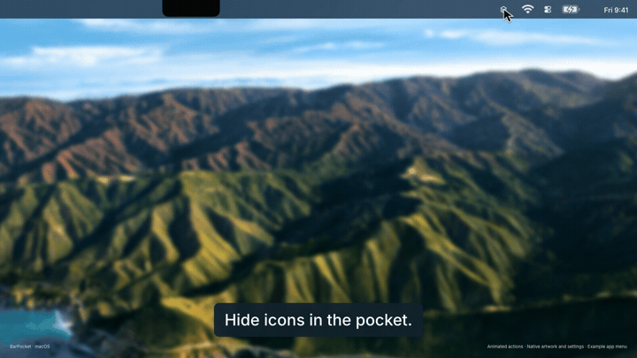
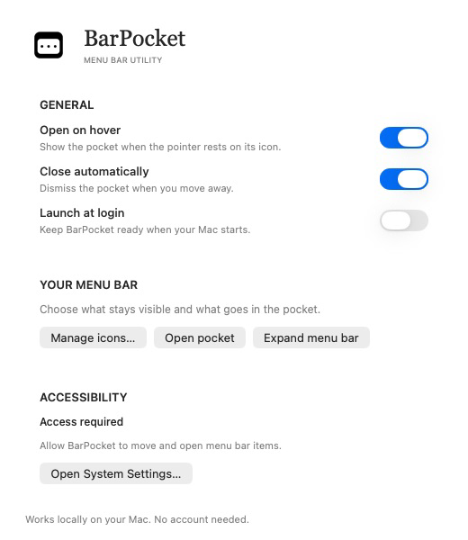
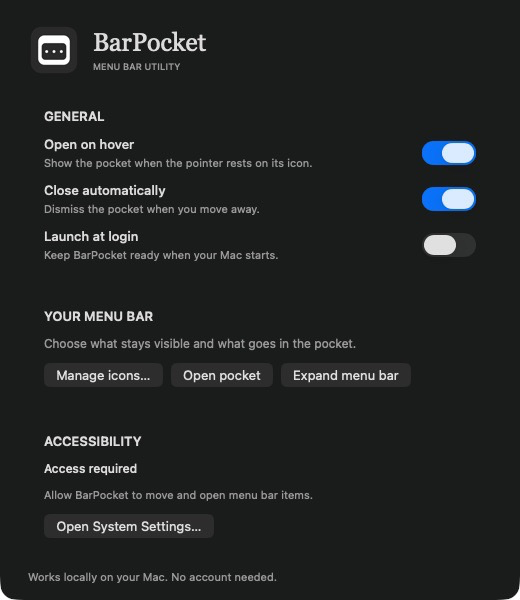
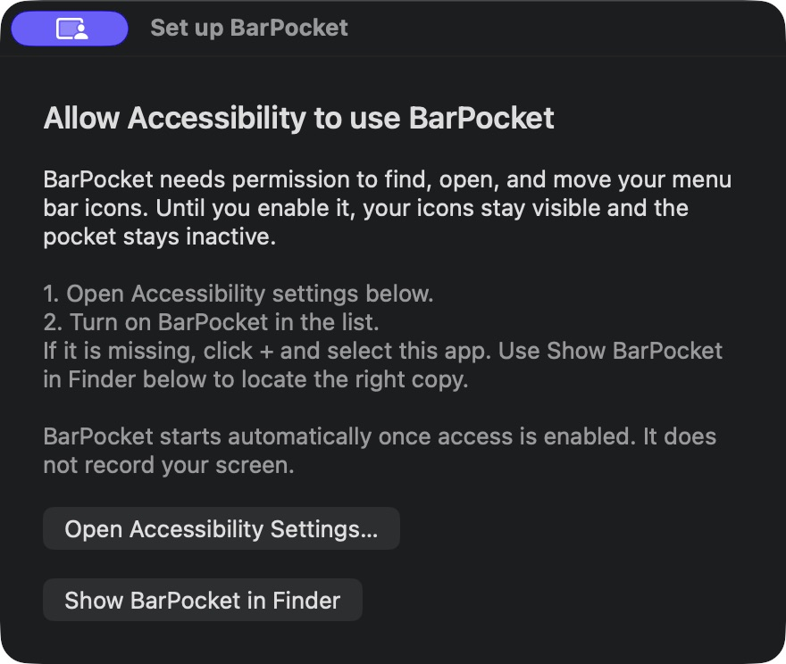

<p align="center">
  
</p>

<h1 align="center">BarPocket</h1>

<p align="center">
  <strong>Keep menu bar icons in a pocket.</strong><br>
  A native macOS app that keeps less-used icons below the menu bar.
</p>

<p align="center">
  <a href="#the-short-version">What it does</a> ·
  <a href="#get-it-running">Install</a> ·
  <a href="#the-controls">Controls</a> ·
  <a href="#honest-fine-print">Limitations</a> ·
  <a href="docs/TROUBLESHOOTING.md">Troubleshooting</a>
</p>

> [!NOTE]
> BarPocket is an experimental, MIT-licensed public source release. There is no notarized download yet; build it on your Mac using the steps below.

## The short version

BarPocket hides less-used menu bar items and shows them in a compact row **below** the bar. You can reach them without losing them behind the MacBook notch.

| Need | BarPocket's answer |
| --- | --- |
| Hide less-used icons | Items left of its divider stay out of the visible menu bar. |
| Open the pocket | Click or hover over BarPocket to open the pocket. |
| Keep an item visible | Drag it from the pocket to the menu bar. |
| Put an item back | Drag it onto BarPocket or the open pocket. |
| An app that intercepts dragging | Use **Manage icons…** in Settings. |

No subscription or account. Brief local still captures supply the real menu bar artwork; no video or audio stream runs.

## Features

- **Click or hover to open.** Hidden icons appear in a compact row below the menu bar. Optional automatic closing dismisses it when your pointer leaves.
- **Actual icon artwork.** Transparent backgrounds and original menu bar sizes are preserved; no initials replace the icons.
- **Status badges.** Icon stills refresh every three seconds while the pocket is open, including coloured badges and battery state. Faster animations can be skipped.
- **Native app menus.** Click an icon to activate its original menu bar item. When the opened menu is detected, the item returns after the menu closes.
- **Drag in either direction.** Drag from the pocket to keep an icon visible, or drag it back to hide it. Visible-item choices are saved; some apps may need repinning after restart.
- **New and closed apps.** New or reopened items receive fresh artwork; closed items are removed.
- **Light and dark appearance.** Settings and the pocket follow macOS appearance. Monochrome artwork adapts while coloured badges remain intact.
- **Manage icons.** Move items from Settings when a third-party app intercepts dragging. Temporary menu bar expansion is also available.
- **Permission setup.** Native items stay visible until Accessibility, Screen Recording access and usable icon images are available.
- **One running instance.** Launching another copy activates the existing app.
- **Native settings.** Choose hover opening, automatic closing and launch at login.
- **Local operation.** No account, analytics, image uploads, video stream or audio capture. A normal quit restores hidden items.

## Watch the demo

[](https://github.com/Abdulrhman02/BarPocket/raw/refs/heads/main/docs/media/barpocket-demo.mp4)

[Watch or download the 42-second demo](https://github.com/Abdulrhman02/BarPocket/raw/refs/heads/main/docs/media/barpocket-demo.mp4).
The approved v0.8 demo shows opening an app menu, dragging an icon out and back, status badges, and current light/dark settings. Interactions are animated; icon artwork, the example AppKit menu and settings views are native assets. The example app’s red/green badge illustrates a status change. The divider is omitted for clarity; the real app uses one to hide native items.

## Settings

Settings start with General: native switches, short explanations, and light/dark surfaces that follow your system appearance.

<p align="center">
  
  
</p>

## Get it running

### Requirements

- macOS 14 Sonoma or later for still icon capture. Development testing has been on Apple silicon with macOS 26.5.2.
- Xcode or the Xcode Command Line Tools.
- Accessibility and Screen Recording access for BarPocket (macOS uses that name even for still images).

### Build from source

```sh
git clone https://github.com/Abdulrhman02/BarPocket.git
cd BarPocket
./build.sh
open dist/BarPocket.app
```

`build.sh` creates `dist/BarPocket.app` for your Mac's architecture and signs it locally. It does not install or replace the app already in `/Applications`.

For everyday use, quit BarPocket, copy the built app to `/Applications`, and launch **that copy**. Keep launching the same copy: macOS can treat a moved or rebuilt app as a different Accessibility entry. If you have a signing certificate, you can use it instead of the default ad hoc signature:

```sh
CODESIGN_IDENTITY="Apple Development: Your Name (TEAMID)" ./build.sh
```

There is no signed and notarized public binary yet. A Developer ID signature and notarization are needed before a download can offer the usual macOS installation experience.

### First launch

1. Open BarPocket. A **Set up BarPocket** window explains Accessibility access. Your native menu bar icons remain visible; hiding and pocket interactions stay inactive.
2. Click **Open Accessibility Settings…**. This requests access from macOS and opens **System Settings → Privacy & Security → Accessibility**.
3. Enable the BarPocket copy you are launching. If it is missing from the list, click **+** and select the app. **Show BarPocket in Finder** in setup reveals the exact running copy. If macOS asks to quit and reopen it, follow that prompt. Otherwise BarPocket detects the change automatically. The pocket activates once both permissions and usable icon images are available.
4. Allow **icon images** when prompted, then enable BarPocket in **Screen & System Audio Recording**. Follow macOS’s Quit & Reopen prompt. BarPocket captures native menu bar window artwork at Retina resolution. It refreshes status images every three seconds while the pocket is open. That periodic status refresh stops when it closes.
5. Click its menu bar icon to see the hidden items below the bar. Before permission is enabled, clicking returns to setup instead of opening general Settings.

<p align="center"></p>

If you remove Accessibility access later, BarPocket closes the pocket and restores the native icons to view. Closing setup without granting access leaves the app inactive and the icons visible.

If the switch says “on” but BarPocket still cannot see items, [try the permission reset steps](docs/TROUBLESHOOTING.md#accessibility-is-on-but-barpocket-cannot-see-icons).

## The controls

| Do this | To do that |
| --- | --- |
| Click the BarPocket icon | Open or close the pocket. |
| Hover over it | Open the pocket after a short pause, if hover is enabled. |
| Click an item in the pocket | Activate its native menu bar item. |
| Hold and drag a pocket item onto the menu bar | Keep it visible. |
| Drag a visible item onto BarPocket or the open pocket | Put it back in the pocket. |
| Right-click BarPocket | Open Settings, show hidden items, expand temporarily, or quit. |
| Open **Settings → Manage icons…** | Move an item when normal dragging gets intercepted. |

Settings also has the hover, automatic closing, and launch-at-login switches. BarPocket allows one running instance per macOS user. Launching another copy activates the existing app instead of adding more menu bar items.

## Permissions and privacy

BarPocket uses **Accessibility** to discover, click, and move native menu bar items. **Screen Recording** permission is used for brief still captures of their icon rectangles. It does not create a video stream, capture audio, use your microphone, send analytics, or upload images.

Images and their owner-process identities are cached locally in macOS preferences. New or reopened apps receive a new still capture; closed apps are removed from the pocket. Light/dark appearance or display changes trigger a refresh. Unchanged items reuse their images, including when BarPocket restarts while those apps are still running. While the pocket is open, icon stills refresh every three seconds so coloured badges, battery state, and other status changes appear automatically. Opening the pocket also refreshes immediately. This is sampled status, not frame-by-frame animation; changes faster than three seconds may be skipped. The periodic status refresh stops when the pocket closes. New/reopened items, appearance/display changes, and initial image recovery can still need a capture while closed. A failed initial capture gets at most three attempts, with 30 seconds between retries; the group stays visible. **Refresh icons** starts a fresh attempt budget.

Native icon-window captures preserve transparent backgrounds and coloured status badges, including items outside the visible menu bar. The pocket uses a macOS popover surface and preserves the artwork’s native menu bar point size. Monochrome artwork uses native light/dark tinting; dark neutral ink in mixed-colour artwork is adjusted for dark material while coloured badges and alpha remain intact. No wallpaper screenshot or temporary rearrangement is needed. If native capture fails, the group stays visible; initials are never substituted. This relies on undocumented WindowServer window discovery and a deprecated still-image API, because the ScreenCaptureKit shareable window list did not expose offscreen status windows in our tests. Future macOS changes may affect compatibility.

## Limitations

macOS does not provide a public API for hiding another app's status item. BarPocket uses its own status items to move a group of items out of view, then Accessibility to find and interact with them. This works well for many apps, but some protected system items and unusual menus resist moving or activation.

If an item's menu cannot be detected, BarPocket may leave its native item visible so you can click it directly. **Manage icons…** and temporary expansion are there for those cases. Details live in [How it works](docs/HOW_IT_WORKS.md) and [Troubleshooting](docs/TROUBLESHOOTING.md).

## Around the repo

| Path | What lives there |
| --- | --- |
| `main.swift` | The native AppKit app. |
| `build.sh` | A one-command local build. |
| `BarPocket.icns`, `icon-1024.png` | The graphite app icon and its source artwork. |
| `PocketLight.png`, `PocketDark.png` | Preserved monochrome brand artwork. |
| `IconSnapshots.swift` | Native transparent stills, artwork sizing, badge preservation and blank-image rejection. |
| `SingleInstance.swift` | Shared per-user process lock. |
| `docs/media/` | Full landscape demo and animated README preview. |
| `generate_icon.swift` | Script that regenerates the PNG artwork. |
| `docs/` | Behavior notes and fixes for common problems. |
| `dist/` | Your local build output; ignored by Git. |

Found a bug or have an idea? [Open an issue](https://github.com/Abdulrhman02/BarPocket/issues) with your macOS version, the affected app, and a short reproduction. [Contributions are welcome](CONTRIBUTING.md). Please check screenshots for private menu bar or desktop content before attaching them.

## Development checks

```sh
python3 Tests/test_single_instance.py
python3 Tests/test_accessibility_flow.py
python3 Tests/test_icon_snapshots.py
python3 Tests/test_layout_and_drag.py
```

This compiles the production process lock, verifies that a second process cannot acquire it, then checks that termination releases it for the next launch.

The Accessibility check exercises denied access, activation after granting access, and restoration after revoking it using a simulated trust result. It does not grant system permissions or move real menu bar items.

Right-to-left interfaces keep the icon row in the native menu bar’s physical order. Drag targets use the native window coordinates on the item’s display, including displays above the laptop screen.

## License and release scope

[MIT](LICENSE), copyright Abdulrahman Ali Alghamdi. Version 0.8 is an experimental source release, not a notarized installer. The [release audit](docs/RELEASE_AUDIT.md) lists the checks, fixes, and untested configurations.

Item identities prefer a unique Accessibility identifier, then a native window ID. This prevents a reordered app list from reusing a different item’s artwork. Apps without a stable identifier can receive new window IDs when restarted; their saved pin may need to be set again.
